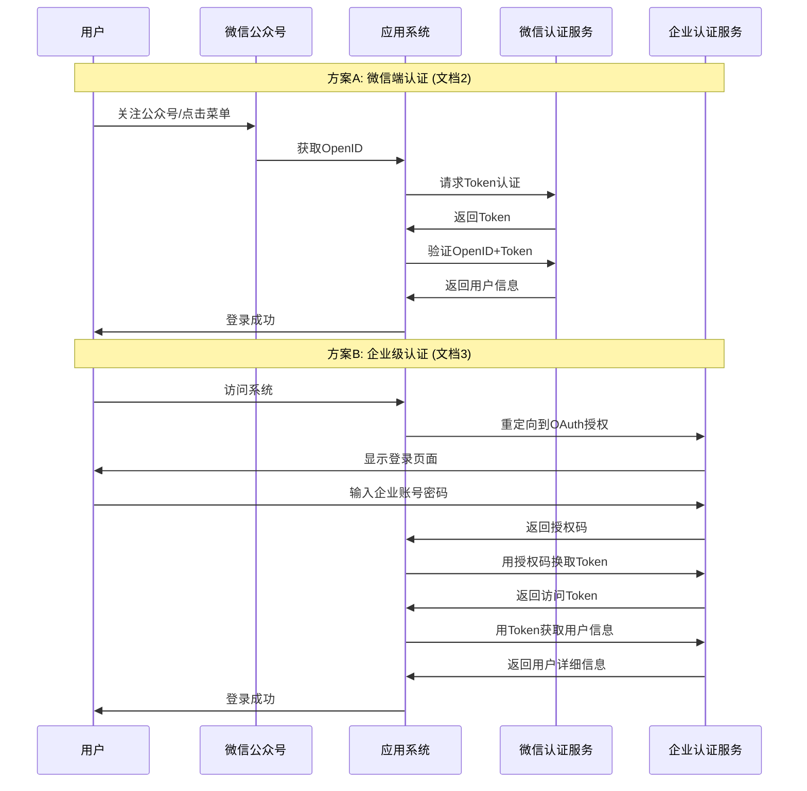
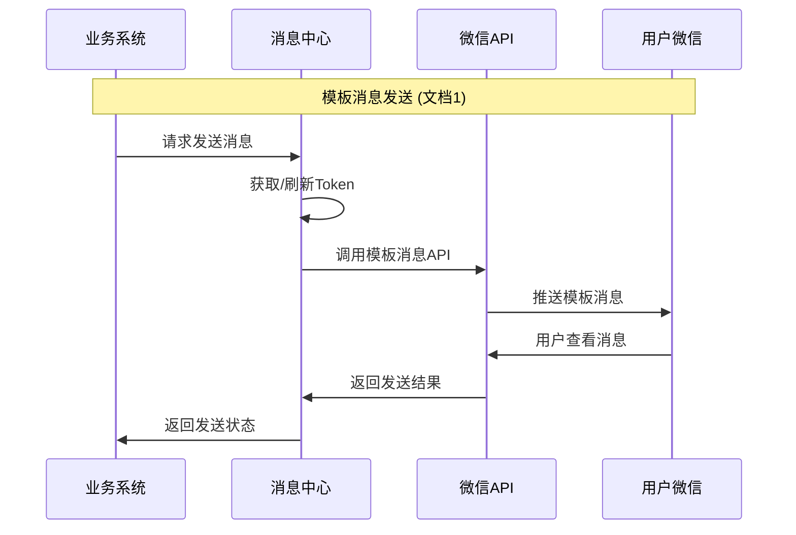

# 三文档作用分析和完整对接流程

## 📋 **三个文档的作用分析**

### 🎯 **为什么需要三个文档？**

这三个文档分别解决了微信公众号接入的**不同层面**的问题，形成了一个完整的技术栈：

```
┌─────────────────────────────────────────────────────────────┐
│                    完整微信接入架构                          │
├─────────────────────────────────────────────────────────────┤
│  文档1: 第三方微信模板消息接口说明                           │
│  作用: 消息发送层 - 如何发送模板消息给用户                   │
│  ├── Token获取和管理                                        │
│  ├── 模板消息发送API                                        │
│  └── 错误码处理                                            │
├─────────────────────────────────────────────────────────────┤
│  文档2: 微端统一身份认证对接文档                             │
│  作用: 身份认证层 - 微信端用户身份验证                       │
│  ├── 微信OpenID获取                                         │
│  ├── 用户身份绑定                                          │
│  └── 简化版OAuth流程                                        │
├─────────────────────────────────────────────────────────────┤
│  文档3: 统一身份认证对接文档 1.1                             │
│  作用: 标准认证层 - 标准OAuth2.0实现                        │
│  ├── 完整OAuth2.0流程                                       │
│  ├── 企业级身份认证                                        │
│  └── 权限管理和授权                                        │
└─────────────────────────────────────────────────────────────┘
```

### 📊 **各文档详细作用**

#### **文档1: 第三方微信模板消息接口说明**
**核心作用**: 消息推送服务
- **服务地址**: `172.16.144.17:8080/msgcenter/`
- **主要功能**: 
  - 获取微信API访问凭证
  - 发送模板消息给关注用户
  - 处理发送结果和错误
- **适用场景**: 系统主动向用户推送通知

#### **文档2: 微端统一身份认证对接文档**  
**核心作用**: 微信用户身份验证
- **服务地址**: `wechatoauth.stiei.edu.cn`
- **主要功能**:
  - 微信OpenID获取和验证
  - 用户身份与系统账号绑定
  - 简化的认证流程
- **适用场景**: 微信公众号内用户登录

#### **文档3: 统一身份认证对接文档 1.1**
**核心作用**: 企业级标准认证
- **服务地址**: `4d-api.stiei.edu.cn`
- **主要功能**:
  - 标准OAuth2.0 Authorization Code流程
  - 企业用户统一身份认证
  - 完整的权限管理
- **适用场景**: 企业内部系统集成

## 🔄 **完整对接流程**

### **阶段1: 用户身份认证流程**



### **阶段2: 消息发送流程**



## 🛠️ **具体技术实现流程**

### **步骤1: 环境准备**
```bash
# 1. 确保服务器环境
- 域名: 已备案的域名
- SSL: 有效的HTTPS证书  
- 网络: 能访问微信API和认证服务
- IP: 配置在微信白名单中

# 2. 获取必要的凭证
- 微信AppID: wxb1daea392d68c3f5
- 微信Secret: 508522de4db7fe950ffee405acf7b25
- OAuth ClientID: 40x3rOwFWCpepY5NBxUvF0C1zye8AtYE2mhgOzaaCgc
- OAuth Secret: N3_TLmjA7Pt6tiuWazZNOKPDJdTl6cn9inHW3Qo1kHs
```

### **步骤2: 实现认证模块**

#### **方案A: 微信端认证 (适用于公众号内)**
```python
class WeChatAuthService:
    def __init__(self):
        self.auth_url = "http://wechatoauth.stiei.edu.cn"
        self.token_url = "http://token.stiei.edu.cn/stieiapi/puttoken"
    
    async def get_auth_token(self):
        """获取认证Token"""
        data = {
            "AppId": "174f12c93415106275cba488e241f48c",
            "AppKey": "e8519d13fa8536e5d94289f4d5dde094"
        }
        response = await self.post(self.token_url, data)
        return response['token']
    
    async def authenticate_user(self, openid, redirect_uri):
        """用户认证"""
        token = await self.get_auth_token()
        auth_url = f"{self.auth_url}/oauth/authopenid"
        params = {
            "token": token,
            "openid": openid, 
            "redirectUri": redirect_uri
        }
        return self.redirect_to(auth_url, params)
    
    async def get_user_info(self, params_value):
        """获取用户信息"""
        url = f"{self.auth_url}/oauth/putuserinfo"
        response = await self.post(url, {"paramsvalue": params_value})
        return response
    
    async def release_openid(self, openid):
        """释放OpenID"""
        url = f"{self.auth_url}/oauth/releaseopenid"
        await self.post(url, {"openid": openid})
```

#### **方案B: 企业级认证 (适用于企业系统)**
```python
class EnterpriseAuthService:
    def __init__(self):
        self.base_url = "http://4d-api.stiei.edu.cn/4d"
        self.client_id = "40x3rOwFWCpepY5NBxUvF0C1zye8AtYE2mhgOzaaCgc"
        self.client_secret = "N3_TLmjA7Pt6tiuWazZNOKPDJdTl6cn9inHW3Qo1kHs"
    
    def get_auth_url(self, redirect_uri, state):
        """生成授权URL"""
        params = {
            "response_type": "code",
            "client_id": self.client_id,
            "state": state,
            "redirect_uri": redirect_uri,
            "scope": "user:read"
        }
        return f"{self.base_url}/soa-auth/oauth_2/authorize?" + urlencode(params)
    
    async def get_access_token(self, code, redirect_uri):
        """获取访问Token"""
        auth_header = base64.b64encode(
            f"{self.client_id}:{self.client_secret}".encode()
        ).decode()
        
        headers = {"Authorization": f"Basic {auth_header}"}
        data = {
            "grant_type": "authorization_code",
            "code": code,
            "redirect_uri": redirect_uri,
            "client_id": self.client_id
        }
        
        response = await self.post(
            f"{self.base_url}/soa-auth/oauth_2/token",
            data, headers
        )
        return response['access_token']
    
    async def get_user_profile(self, access_token):
        """获取用户信息"""
        headers = {
            "Authorization": f"Bearer {access_token}",
            "Accept": "application/json"
        }
        response = await self.get(
            f"{self.base_url}/campus-api/oauth_2/profile",
            headers=headers
        )
        return response
```

### **步骤3: 实现消息发送模块**
```python
class WeChatMessageService:
    def __init__(self):
        self.base_url = "http://172.16.144.17:8080/msgcenter"
        self.app_id = "wxb1daea392d68c3f5"
        self.app_secret = "508522de4db7fe950ffee405acf7b25"
        self.access_token = None
        self.token_expires_at = 0
    
    async def get_access_token(self):
        """获取微信访问Token"""
        if time.time() >= self.token_expires_at - 300:  # 提前5分钟刷新
            await self.refresh_token()
        return self.access_token
    
    async def refresh_token(self):
        """刷新Token"""
        params = {
            "appid": self.app_id,
            "secret": self.app_secret
        }
        response = await self.get(f"{self.base_url}/msg_getToken", params)
        
        if response['errcode'] == '0':
            self.access_token = response['access_token']
            self.token_expires_at = time.time() + int(response['expires_in'])
        else:
            raise Exception(f"Token获取失败: {response['errmsg']}")
    
    async def send_template_message(self, user_ids, template_data):
        """发送模板消息"""
        token = await self.get_access_token()
        
        data = {
            "token": token,
            "msgContent": template_data,
            "userIds": [{"userId": uid} for uid in user_ids]
        }
        
        response = await self.post(f"{self.base_url}/msg_sendWeChatMessage", data)
        
        if response['errCode'] != '0':
            raise Exception(f"消息发送失败: {response['errmsg']}")
        
        return response
```

### **步骤4: 集成到AgentScope**
```python
class WeChatIntegrationAgent(OptimizedSpecializedAgent):
    def __init__(self):
        super().__init__(
            role=AgentRole.COMMUNICATION_MANAGER,
            supported_tasks=[TaskType.USER_NOTIFICATION, TaskType.MESSAGE_SENDING]
        )
        self.auth_service = WeChatAuthService()
        self.message_service = WeChatMessageService()
    
    async def notify_analysis_complete(self, analysis_result, user_openids):
        """分析完成通知"""
        template_data = {
            "template_id": "analysis_complete_template",
            "url": f"https://your-domain.com/results/{analysis_result.id}",
            "topcolor": "#FF0000",
            "data": {
                "Project": {"value": analysis_result.project_name, "color": "#173177"},
                "Score": {"value": str(analysis_result.quality_score), "color": "#173177"},
                "Issues": {"value": str(len(analysis_result.issues)), "color": "#173177"},
                "Time": {"value": analysis_result.completed_at, "color": "#173177"}
            }
        }
        
        await self.message_service.send_template_message(user_openids, template_data)
```

## 🎯 **推荐的集成策略**

### **场景1: 企业内部系统** (推荐文档3)
- 使用标准OAuth2.0流程
- 与企业AD/LDAP集成
- 完整的权限管理

### **场景2: 微信公众号服务** (推荐文档2+文档1)
- 微信内用户认证
- 模板消息推送
- 简化的用户体验

### **场景3: 混合模式** (三个文档都用)
- 企业用户: 使用文档3的OAuth2.0
- 微信用户: 使用文档2的微信认证  
- 消息推送: 统一使用文档1的消息接口

## ⚠️ **关键注意事项**

1. **Token管理**: 三套系统都有独立的Token，需要分别管理
2. **用户映射**: 需要建立微信OpenID与企业用户ID的映射关系
3. **错误处理**: 每个接口都有不同的错误码，需要分别处理
4. **安全考虑**: 所有敏感信息都要加密存储和传输
5. **限流保护**: 避免超出各个服务的调用限制

这样的三文档设计确保了系统的**模块化**和**可扩展性**，可以根据实际需求选择合适的认证方式和功能组合。
