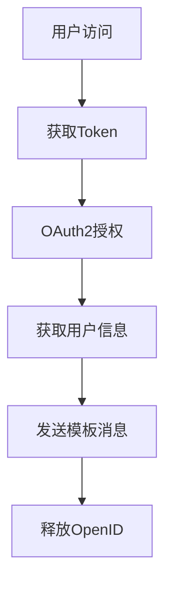

# 微信公众号接入分析报告

> 基于现有文档分析微信公众号接入的技术要求、限制和注意事项

## 📋 **文档概览**

基于转换的三个核心文档：

1. **第三方微信模板消息接口说明** - 模板消息发送API规范
2. **微端统一身份认证对接文档** - OAuth2认证流程
3. **统一身份认证对接文档 1.1** - 完整的OAuth2实现规范

## 🔍 **技术架构分析**

### 核心组件
- **消息中心服务**: `172.16.144.17:8080/msgcenter/`
- **OAuth认证服务**: `wechatoauth.stiei.edu.cn`
- **API网关**: `4d-api.stiei.edu.cn`
- **Token服务**: `token.stiei.edu.cn`

### 认证流程


## ⚠️ **关键限制和注意事项**

### 1. **API调用频率限制**

#### Token管理
- **Token有效期**: 7200秒 (2小时)
- **Token获取**: 需要appid和secret
- **Token刷新**: 必须在过期前重新获取

#### 消息发送限制
- **IP白名单**: 必须配置允许的IP地址
- **请求方式**: 仅支持POST请求
- **数据格式**: 必须是JSON格式

### 2. **消息发送规范**

#### 模板消息要求
```json
{
  "template_id": "ngqIpbwh8bUfcSsECmogfXcV14J0tQlEpBO27izEYtY",
  "url": "http://weixin.qq.com/download",
  "topcolor": "#FF0000",
  "data": {
    "User": {"value": "黄先生", "color": "#173177"},
    "Date": {"value": "06月07日 19时24分", "color": "#173177"}
  }
}
```

#### 关键限制
- **模板ID**: 必须使用已审核通过的模板
- **用户ID**: 必须是已关注的用户
- **消息内容**: 不能包含敏感信息
- **发送频率**: 避免频繁发送造成用户骚扰

### 3. **安全认证要求**

#### OAuth2.0 标准
- **协议**: 严格遵循RFC 6749标准
- **授权模式**: Authorization Code模式
- **Scope权限**: 明确定义访问范围

#### 安全措施
- **State参数**: 防止CSRF攻击
- **HTTPS**: 生产环境必须使用HTTPS
- **Client Secret**: 服务端安全存储
- **Token加密**: Base64编码传输

### 4. **用户隐私保护**

#### 数据收集限制
- **最小化原则**: 只收集必要的用户信息
- **明确授权**: 用户必须明确同意数据使用
- **数据存储**: 遵循数据保护法规

#### OpenID管理
- **获取**: 通过微信授权获得
- **使用**: 仅用于身份识别
- **释放**: 使用完毕后及时释放

## 🚨 **常见错误码和处理**

### Token相关错误
| 错误码 | 错误信息 | 解决方案 |
|--------|----------|----------|
| 40015 | IP鉴权失败 | 配置IP白名单 |
| 40010 | 参数缺失 | 检查必需参数 |
| 40014 | 认证失败 | 验证appid/secret |
| 40011 | 无效token | 重新获取token |
| 40013 | token超时 | 刷新token |

### 消息发送错误
| 错误码 | 错误信息 | 解决方案 |
|--------|----------|----------|
| 40018 | 必须POST请求 | 使用POST方法 |
| 30010 | 无请求数据 | 检查请求体 |
| 30011 | 非JSON格式 | 格式化JSON数据 |
| 30013 | JSON参数缺失 | 补充必需字段 |
| 30014 | 网络异常 | 检查网络连接 |

## 📊 **性能优化建议**

### 1. **Token管理优化**
```python
class TokenManager:
    def __init__(self):
        self.token = None
        self.expires_at = 0
    
    def get_valid_token(self):
        if time.time() >= self.expires_at - 300:  # 提前5分钟刷新
            self.refresh_token()
        return self.token
    
    def refresh_token(self):
        # 获取新token的逻辑
        pass
```

### 2. **消息队列处理**
- **异步发送**: 避免阻塞主线程
- **批量处理**: 合并多个用户的消息
- **重试机制**: 失败消息自动重试
- **限流控制**: 控制发送频率

### 3. **缓存策略**
- **Token缓存**: Redis存储token
- **用户信息缓存**: 减少重复查询
- **模板缓存**: 缓存常用模板

## 🔧 **技术实现建议**

### 1. **系统架构设计**
```
┌─────────────────┐    ┌─────────────────┐    ┌─────────────────┐
│   前端应用      │    │   业务服务      │    │   微信API       │
│                 │    │                 │    │                 │
│ - 用户界面      │───▶│ - 身份认证      │───▶│ - 模板消息      │
│ - 消息触发      │    │ - 消息管理      │    │ - 用户管理      │
│ - 状态展示      │    │ - 队列处理      │    │ - Token管理     │
└─────────────────┘    └─────────────────┘    └─────────────────┘
```

### 2. **数据库设计**
```sql
-- 用户表
CREATE TABLE wx_users (
    id BIGINT PRIMARY KEY,
    openid VARCHAR(64) UNIQUE,
    user_id VARCHAR(32),
    nickname VARCHAR(64),
    created_at TIMESTAMP,
    updated_at TIMESTAMP
);

-- 消息记录表
CREATE TABLE wx_messages (
    id BIGINT PRIMARY KEY,
    template_id VARCHAR(64),
    openid VARCHAR(64),
    content JSON,
    status ENUM('pending', 'sent', 'failed'),
    error_msg TEXT,
    created_at TIMESTAMP
);

-- Token管理表
CREATE TABLE wx_tokens (
    id INT PRIMARY KEY,
    access_token TEXT,
    expires_at TIMESTAMP,
    created_at TIMESTAMP
);
```

### 3. **配置管理**
```yaml
wechat:
  app_id: "wxb1daea392d68c3f5"
  app_secret: "${WX_APP_SECRET}"
  
api:
  base_url: "http://172.16.144.17:8080/msgcenter"
  timeout: 30
  retry_times: 3
  
oauth:
  client_id: "40x3rOwFWCpepY5NBxUvF0C1zye8AtYE2mhgOzaaCgc"
  client_secret: "${OAUTH_CLIENT_SECRET}"
  redirect_uri: "https://your-domain.com/callback"
```

## 🎯 **接入实施计划**

### 阶段1: 基础接入 (1-2周)
- [ ] 申请微信公众号
- [ ] 配置开发者信息
- [ ] 实现Token获取
- [ ] 测试基础API调用

### 阶段2: 功能开发 (2-3周)
- [ ] 实现OAuth2认证流程
- [ ] 开发模板消息发送
- [ ] 建立用户管理系统
- [ ] 实现消息队列

### 阶段3: 优化完善 (1-2周)
- [ ] 性能优化
- [ ] 错误处理完善
- [ ] 监控告警系统
- [ ] 安全加固

### 阶段4: 上线部署 (1周)
- [ ] 生产环境配置
- [ ] 安全审核
- [ ] 压力测试
- [ ] 正式上线

## 📚 **相关资源**

### 官方文档
- [微信公众平台开发文档](https://developers.weixin.qq.com/doc/)
- [OAuth 2.0 RFC 6749](https://tools.ietf.org/html/rfc6749)

### 开发工具
- [微信开发者工具](https://developers.weixin.qq.com/miniprogram/dev/devtools/download.html)
- [接口调试工具](https://mp.weixin.qq.com/debug/)

## 🚀 **AgentScope集成方案**

### 与AgentScope多智能体系统集成

基于我们已有的AgentScope架构，可以将微信公众号作为一个新的通信渠道：

```python
# 微信公众号智能体
class WeChatAgent(OptimizedSpecializedAgent):
    def __init__(self):
        super().__init__(
            role=AgentRole.COMMUNICATION_MANAGER,
            supported_tasks=[TaskType.MESSAGE_SENDING, TaskType.USER_NOTIFICATION]
        )
        self.wx_api = WeChatAPIClient()
        self.token_manager = TokenManager()

    async def send_template_message(self, users, template_data):
        """发送模板消息"""
        token = await self.token_manager.get_valid_token()

        for user in users:
            message_task = AgentTask(
                task_type=TaskType.MESSAGE_SENDING,
                parameters={
                    "user_id": user.user_id,
                    "template_data": template_data,
                    "token": token
                }
            )

            result = await self.execute_task(message_task)
            await self.log_message_result(user, result)
```

### 集成到现有工作流

```python
# 在AgentScope工作流中使用微信通知
async def code_analysis_with_notification(project_path, users):
    # 1. 代码分析
    analysis_agent = CodeManagerAgent()
    analysis_result = await analysis_agent.analyze_project(project_path)

    # 2. 发送微信通知
    wechat_agent = WeChatAgent()
    notification_data = {
        "template_id": "analysis_complete_template",
        "data": {
            "project": {"value": project_path},
            "score": {"value": str(analysis_result.quality_score)},
            "issues": {"value": str(len(analysis_result.issues))}
        }
    }

    await wechat_agent.send_template_message(users, notification_data)
```

## 🔒 **安全最佳实践**

### 1. **敏感信息保护**
- 使用环境变量存储密钥
- 实施密钥轮换机制
- 加密存储用户数据
- 定期安全审计

### 2. **访问控制**
- 实施IP白名单
- 使用HTTPS传输
- 实施请求签名验证
- 限制API调用频率

### 3. **数据合规**
- 遵循GDPR/个人信息保护法
- 实施数据最小化原则
- 提供数据删除功能
- 建立隐私政策

## 📈 **监控和运维**

### 关键指标监控
- Token刷新成功率
- 消息发送成功率
- API响应时间
- 错误率统计

### 告警机制
- Token即将过期告警
- 消息发送失败告警
- API异常告警
- 用户投诉监控

---

**⚠️ 重要提醒**: 在正式接入前，务必详细阅读微信公众平台的最新政策和技术文档，确保合规性和安全性。

**🎯 下一步行动**: 建议先在测试环境中实现基础功能，验证技术可行性后再进行生产环境部署。
