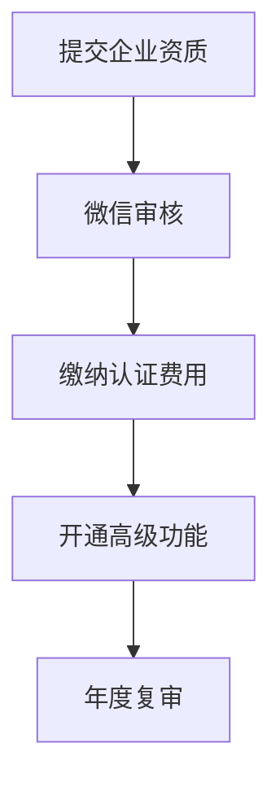

# 微信公众号限制和注意事项详解

> 基于官方文档和实际接入经验总结的微信公众号关键限制

## 🚨 **核心限制概览**

### 1. **账号类型限制**

| 账号类型 | 功能限制 | 认证要求 | 适用场景 |
|----------|----------|----------|----------|
| 个人订阅号 | 无模板消息、无自定义菜单 | 身份证认证 | 个人博客、资讯 |
| 企业订阅号 | 有限模板消息、基础菜单 | 企业资质认证 | 企业宣传 |
| 企业服务号 | 完整功能 | 企业认证+微信认证 | 企业服务 |
| 小程序 | 独立生态 | 企业认证 | 应用服务 |

### 2. **API调用频率限制**

#### 基础限制
- **普通接口**: 100万次/天
- **发送消息**: 根据粉丝数量动态调整
- **获取Token**: 2000次/天
- **用户信息**: 5000万次/天

#### 模板消息限制
```
订阅号: 无模板消息功能
服务号: 
  - 未认证: 1000条/天
  - 已认证: 10万条/天 (根据粉丝数)
  - 单用户: 最多4条/天
```

## 📊 **消息发送限制详解**

### 1. **模板消息限制**

#### 发送条件
- ✅ 用户必须关注公众号
- ✅ 用户在48小时内有交互行为
- ✅ 模板必须通过微信审核
- ✅ 内容不能包含营销信息

#### 内容限制
```json
{
  "限制项": {
    "标题长度": "最多20个字符",
    "内容长度": "最多200个字符", 
    "链接": "必须是https且已备案",
    "颜色": "仅支持16进制颜色码",
    "变量数量": "最多10个变量"
  }
}
```

#### 行业限制
- ❌ **禁止行业**: 金融投资、医疗保健、教育培训等
- ⚠️ **限制行业**: 需要特殊资质和审核
- ✅ **开放行业**: 一般商业服务

### 2. **客服消息限制**

#### 发送窗口
- **主动发送**: 用户发消息后48小时内
- **被动回复**: 用户发消息后5秒内必须回复
- **消息类型**: 文本、图片、语音、视频、图文

#### 频率控制
```
- 单用户单日: 最多100条
- 总量限制: 根据粉丝数动态调整
- 发送间隔: 建议不少于1秒
```

## 🔐 **认证和安全限制**

### 1. **开发者认证**

#### 必需条件
- **企业主体**: 必须是已注册的企业
- **域名备案**: 服务器域名必须ICP备案
- **HTTPS**: 生产环境必须使用HTTPS
- **IP白名单**: 配置服务器IP白名单

#### 认证流程


### 2. **接口安全限制**

#### Token管理
- **有效期**: 7200秒 (2小时)
- **获取频率**: 建议提前5分钟刷新
- **并发限制**: 同时只能有一个有效token
- **存储要求**: 必须安全存储，不能泄露

#### 签名验证
```python
# 微信签名验证示例
def verify_signature(signature, timestamp, nonce, token):
    """验证微信服务器签名"""
    tmp_list = [token, timestamp, nonce]
    tmp_list.sort()
    tmp_str = ''.join(tmp_list)
    tmp_str = hashlib.sha1(tmp_str.encode()).hexdigest()
    return tmp_str == signature
```

## 📱 **用户交互限制**

### 1. **菜单功能限制**

#### 订阅号
- ❌ 无自定义菜单
- ✅ 仅支持默认菜单

#### 服务号
- ✅ 最多3个一级菜单
- ✅ 每个一级菜单最多5个二级菜单
- ✅ 菜单名称最多16个字符
- ✅ 支持点击、跳转、扫码等类型

### 2. **用户数据获取限制**

#### 基础信息
```json
{
  "可获取": [
    "openid", "nickname", "headimgurl", 
    "sex", "city", "province", "country"
  ],
  "需授权": [
    "手机号", "真实姓名", "身份证号"
  ],
  "禁止获取": [
    "微信号", "好友列表", "聊天记录"
  ]
}
```

#### 隐私保护要求
- **明确告知**: 必须明确告知用户数据用途
- **最小化原则**: 只收集必要的数据
- **用户同意**: 必须获得用户明确同意
- **数据删除**: 提供数据删除功能

## 🌐 **技术接入限制**

### 1. **服务器要求**

#### 基础要求
- **域名**: 必须有已备案的域名
- **SSL证书**: 必须配置有效的SSL证书
- **响应时间**: 接口响应时间不超过5秒
- **可用性**: 服务可用性不低于99%

#### 网络要求
```yaml
网络配置:
  协议: HTTPS (TLS 1.2+)
  端口: 443 (HTTPS) / 80 (HTTP重定向)
  IP白名单: 配置微信服务器IP
  防火墙: 允许微信服务器访问
```

### 2. **开发限制**

#### 接口调用
- **并发限制**: 建议不超过100并发
- **重试机制**: 失败后指数退避重试
- **错误处理**: 必须处理所有可能的错误码
- **日志记录**: 记录所有API调用日志

#### 代码规范
```python
# 推荐的错误处理模式
async def send_template_message(self, data):
    max_retries = 3
    for attempt in range(max_retries):
        try:
            response = await self.api_client.post('/send', data)
            if response.status_code == 200:
                return response.json()
            elif response.status_code == 40001:  # token过期
                await self.refresh_token()
                continue
            else:
                raise APIError(f"API调用失败: {response.status_code}")
        except Exception as e:
            if attempt == max_retries - 1:
                raise
            await asyncio.sleep(2 ** attempt)  # 指数退避
```

## 📋 **合规要求**

### 1. **内容审核**

#### 禁止内容
- ❌ 政治敏感信息
- ❌ 色情暴力内容  
- ❌ 虚假信息
- ❌ 侵权内容
- ❌ 垃圾广告

#### 审核机制
- **自动审核**: 微信AI自动检测
- **人工审核**: 敏感内容人工复审
- **用户举报**: 用户可举报违规内容
- **处罚机制**: 违规会被限制或封号

### 2. **数据保护**

#### 法律要求
- **个人信息保护法**: 遵循中国个人信息保护法
- **网络安全法**: 遵循网络安全相关法规
- **数据本地化**: 用户数据必须存储在中国境内

#### 技术要求
```python
# 数据加密存储示例
class UserDataManager:
    def encrypt_user_data(self, data):
        """加密用户敏感数据"""
        key = self.get_encryption_key()
        return AES.encrypt(json.dumps(data), key)
    
    def anonymize_logs(self, logs):
        """日志脱敏处理"""
        return re.sub(r'openid=\w+', 'openid=***', logs)
```

## 🎯 **最佳实践建议**

### 1. **架构设计**
- 使用消息队列处理高并发
- 实施熔断机制防止雪崩
- 建立监控告警系统
- 设计降级方案

### 2. **运维管理**
- 定期备份重要数据
- 监控API调用量和成功率
- 建立应急响应机制
- 定期安全审计

### 3. **用户体验**
- 优化消息发送时机
- 提供清晰的操作指引
- 建立用户反馈机制
- 持续优化交互流程

---

**⚠️ 重要提醒**: 微信公众平台政策经常更新，建议定期查看官方文档，确保合规性。在正式上线前，务必在测试环境充分验证所有功能。
